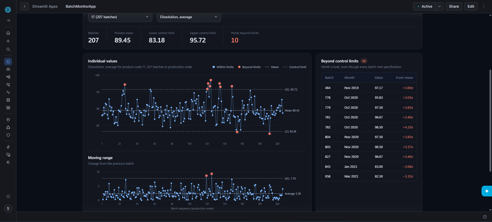
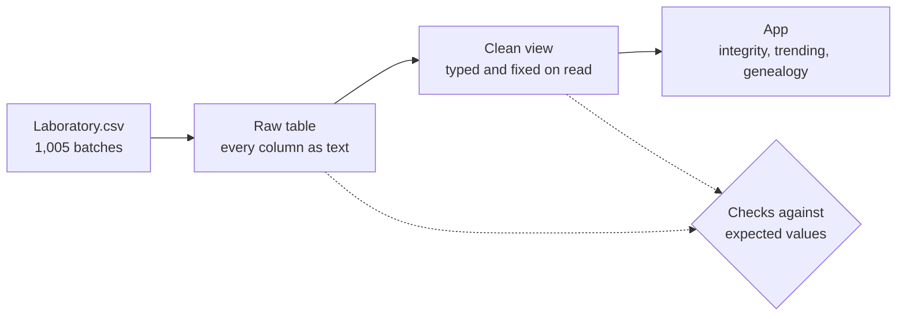
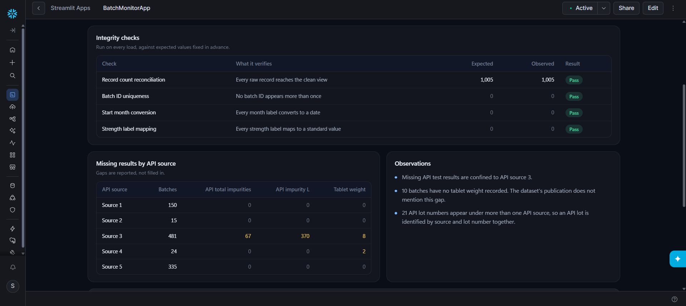
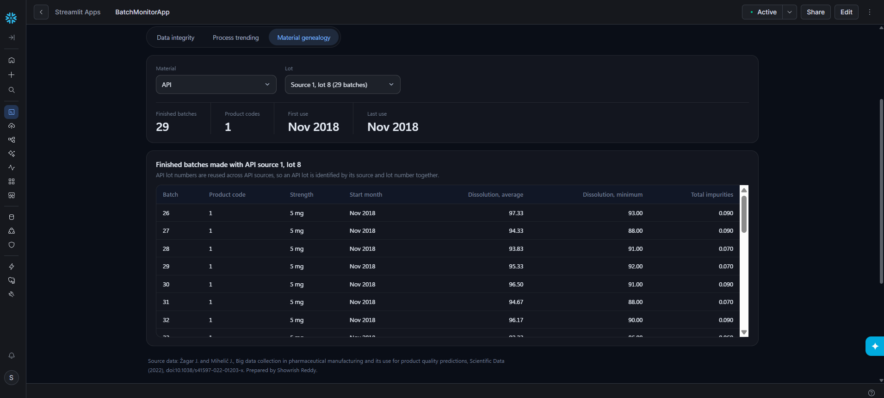

# Batch Monitor

**Trace pharmaceutical batch data from a raw file to verified views and a review dashboard. Built in Snowflake, live on DuckDB.**

An end-to-end data integrity project using **1,005 publicly released production batches**. Batch Monitor preserves the source, standardizes it in a view, reconciles the results against independent pandas calculations, and includes a read-only **Streamlit** app for data checks, process trending, and material genealogy. It was built in Snowflake, and since the trial ended it also runs on DuckDB, which powers the live app.

**[Open the live app](https://batch-monitor.streamlit.app)** · [See profiling findings](#what-profiling-the-file-turned-up) · [How it works](#how-it-works) · [Reproduce the pipeline](#reproduce-it)

| Coverage | Data integrity | Operational analysis |
| :--- | :--- | :--- |
| **1,005 batches · 25 product codes** | Raw source preserved, transformations independently checked, source file fingerprinted | **I-MR charts** with shift and trend rules, quality review, and raw-material genealogy |

`Snowflake` · `DuckDB` · `SQL` · `Python` · `pandas` · `Streamlit` · `HTML / CSS / JavaScript`

> **Demonstration only.** The dataset is public and anonymized. This is not a validated system and must not be used for GMP decisions.

## What profiling the file turned up

| Finding | Why it matters | How it is handled |
|---|---|---|
| Semicolon-delimited export | A default comma load fails | Explicit file format |
| Month labels in Slovenian (`maj`, `avg`, `okt`) | English date parsing breaks on May, Aug and Oct, or silently blanks them | Explicit month mapping |
| Missing values stored as runs of spaces as well as empty fields | Numeric loads reject the spaces | Trimmed, then treated as missing |
| Truncated strength labels (`5MG`, `10M`, `20M`, `40M`) | Inconsistent grouping | Mapped to standard labels |
| 10 batches with no tablet weight | Not mentioned in the dataset's publication | Reported as a known gap |
| 21 API lot numbers appear under more than one API source | Tracing by lot number alone mixes unrelated lots | API lots keyed on source plus lot number |
| Up to 87% of some impurity results exactly 0.050 | Likely a reporting limit, which makes control limits unreliable | The app warns when this applies |

## How it works

The raw table is never edited, so what the app shows can always be traced back to the original file. All cleaning happens in one view. Each step is checked against values written down in advance, and the app re-runs six integrity checks every time it loads.

### In Snowflake (original)

1. **Source file received:** `Laboratory.csv` uploaded to an internal stage.
2. **Landed unchanged:** `RAW.LAB_RESULTS_RAW`, every column stored as text, loaded with `COPY INTO`
   after a dry run (`VALIDATION_MODE`), all or nothing (`ON_ERROR = ABORT_STATEMENT`).
3. **Typed and standardized:** the view `CLEAN.LAB_RESULTS`. Strict conversion (`TO_DOUBLE`) turns blanks into
   missing values and fails loudly on anything else. The raw table is never edited.
4. **Reviewed:** a read-only Streamlit in Snowflake app.

### On DuckDB (live version)

The Snowflake trial has expired, so the `local/` folder rebuilds the same raw table, clean view and checks in DuckDB. It then runs the same app file through `local/app_duckdb.py`, which swaps Snowflake's session for a read-only DuckDB connection.

| Step | Snowflake | DuckDB |
| :--- | :--- | :--- |
| Load | Stage, dry run, all-or-nothing `COPY INTO` | Dry-run parse, then a load into a scratch database |
| Raw table | Every column stored as text | Same |
| Clean view | Strict `TO_DOUBLE` | Same logic, strict `CAST` to `DOUBLE` |
| Checks | SQL in `sql/02_load.sql` and `sql/03_clean_view.sql` | Same expected values in `local/build_duckdb.py`, and the database is only replaced if every check passes |
| Source file | Uploaded to a stage | SHA-256 fingerprint pinned, so the build only accepts the verified file |
| App | Streamlit in Snowflake | The same app file, run by `local/app_duckdb.py` |
| `sql/04` features | Cloning, Time Travel, `UNDROP`, a Data Metric Function, a read-only role | Not ported |

Every step ends with checks against expected values, and the final numbers match an independent pandas
calculation (`verify_profile.py`).

## What the checks prove

| Check | Expected | What it proves |
|---|---|---|
| Rows and unique batches | 1,005 and 1,005 | Nothing was lost or duplicated on load |
| Product codes and start months | 25 and 29 | The whole file was read |
| Stray carriage returns | 0 | Windows line endings didn't leak into values |
| Months parsed and strengths mapped | 0 failures | Every label was understood, none silently dropped |
| Batches per strength | 20 mg 445, 5 mg 249, 10 mg 213, 40 mg 98 | Each strength code mapped to the right label |
| Missing API results | API source 3 only | The gaps match what the dataset's authors documented |
| Missing tablet weights | 8 under API source 3, 2 under API source 4 | Known gaps are reported, not hidden |
| Dissolution average, min and max | 90.65, 82.5, 102.67 | The numbers match an independent pandas check and the published summary |
| Source file SHA-256 | Pinned in the build | The app shows the exact file that was verified |

These checks verify the data. The app is not a validated system in the GMP sense.

## The app

**Live:** [https://batch-monitor.streamlit.app](https://batch-monitor.streamlit.app), running on DuckDB.

* **Data integrity:** source record count, record count reconciliation, batch ID presence and uniqueness, date and label conversion,
  missing results by API source, observations, data lineage, the source file's SHA-256 fingerprint, and the last build's check results.
* **Process trending:** an individuals and moving range (I-MR) chart per product code and quality attribute,
  in production order. Points beyond either chart's control limits are flagged, including unusually large jumps between consecutive batches, and two pattern rules flag points inside them:
  a **shift**, 8 or more batches in a row on one side of the mean (a Western Electric rule), and a **trend**,
  6 or more batches in a row steadily rising or falling (a Nelson rule). Limits are the mean ± 3σ, with σ estimated
  as the average moving range divided by 1.128. Control limits are not specification limits, and every batch met
  its specification, so a flag means "unusual, worth a look," not "failed."
* **Material genealogy:** every finished batch made with a chosen raw material lot.

The dashboard is custom HTML, CSS and JavaScript, fully inline because Streamlit in Snowflake blocks
external scripts, styles and fonts.

## Data

Laboratory data for 1,005 production batches of a film-coated tablet made by direct compression,
Nov 2018 to Apr 2021, across 25 product codes. Each row is one finished batch, with its raw material
lots (genealogy), incoming material tests, in-process tablet checks and final product quality results.

`Laboratory.csv` is from "Big data collection in pharmaceutical manufacturing" by Janja Žagar and Jurij Mihelič,
published on [figshare](https://doi.org/10.6084/m9.figshare.c.5645578) under
[CC BY 4.0](https://creativecommons.org/licenses/by/4.0/). The file is included unchanged, and all cleaning happens
in the views. The dataset is described in Žagar J. and Mihelič J., *Big data collection in pharmaceutical
manufacturing and its use for product quality predictions*, Scientific Data 9, 99 (2022),
[doi:10.1038/s41597-022-01203-x](https://doi.org/10.1038/s41597-022-01203-x).

The file's SHA-256 is `a3b0f16c7c3fa8052b38d767e38fda731a751acc4ec139b52d01577b32dc6483`. Check a downloaded copy with `sha256sum Laboratory.csv`.

## Snowflake features exercised

Warehouses, stages, file formats, `COPY INTO` with validation mode, views, zero-copy cloning, Time Travel
(`BEFORE (STATEMENT => ...)` and `UNDROP`), a Data Metric Function for automatic duplicate checks, a
read-only role, and Streamlit in Snowflake.

## Permissions

The app only runs SELECT queries. In Snowflake, though, a Streamlit app runs with its owner's role, so there it was read-only by design rather than enforced. `BATCH_READER`, the read-only role in `sql/04_exercises.sql`, was a separate exercise. It can only read the clean view, while the app also reads the raw table and its metadata. The DuckDB version opens the database read-only, so there it is enforced.

## Reproduce it

### On DuckDB (no account needed)

    pip install -r local/requirements.txt
    python local/build_duckdb.py
    streamlit run local/app_duckdb.py

The build checks the file's fingerprint before loading anything, then runs every check. The app also builds
the database on its own if it's missing.

### On Snowflake

1. Create a Snowflake account (Enterprise edition, needed for Data Metric Functions).
2. Run `sql/01_setup.sql`, then `sql/02_load.sql`, uploading `Laboratory.csv` to `LAB_STAGE` when prompted.
3. Run `sql/03_clean_view.sql` and compare the checks with their expected values.
4. Optionally run `sql/04_exercises.sql`.
5. Create a Streamlit app in `BATCH_MONITOR.CLEAN` on `PREP_WH` and paste in `app/batch_monitor_app.py`.

## Project files

| Path | Purpose |
| :--- | :--- |
| [`sql/01_setup.sql`](sql/01_setup.sql) | Snowflake environment setup |
| [`sql/02_load.sql`](sql/02_load.sql) | Validate and load the source |
| [`sql/03_clean_view.sql`](sql/03_clean_view.sql) | Typed, standardized view and checks |
| [`sql/04_exercises.sql`](sql/04_exercises.sql) | Optional Snowflake exercises |
| [`app/batch_monitor_app.py`](app/batch_monitor_app.py) | Read-only dashboard |
| [`local/build_duckdb.py`](local/build_duckdb.py) | DuckDB build: fingerprint, raw table, clean view and checks |
| [`local/app_duckdb.py`](local/app_duckdb.py) | Runs the dashboard on DuckDB |
| [`local/local_session.py`](local/local_session.py) | Read-only DuckDB stand-in for Snowflake's session |
| [`local/requirements.txt`](local/requirements.txt) | Packages for the DuckDB version |
| [`Laboratory.csv`](Laboratory.csv) | Source data, CC BY 4.0 |
| [`verify_profile.py`](verify_profile.py) | Independent pandas verification |
| [`.github/workflows/keep-awake.yml`](.github/workflows/keep-awake.yml) | Keeps the live app from going to sleep |
| [`screenshots/`](screenshots/) | Dashboard examples |

## Limitations

* Public, anonymized data. Batch and lot IDs are codes, not real identifiers.
* Oral solid dose tablets, not biologics.
* The source data has no specification limits, so capability indices are not calculated.
* Control limits come from each product code's full history, so they describe that history, not a live process.
* The live app runs on DuckDB. The Snowflake-only exercises in `sql/04` aren't ported.
* Not a validated system.

## License

The code is under the [MIT License](LICENSE). `Laboratory.csv` keeps its own CC BY 4.0 license, described under Data.
